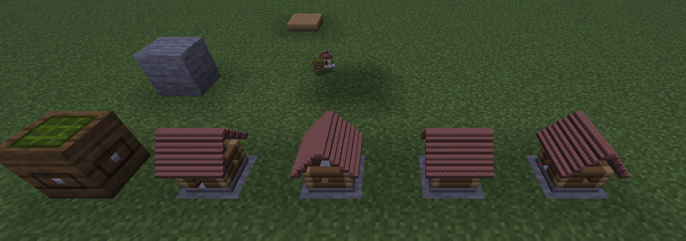

# Minicraft

Build at full size, keep it as one block.

## Screenshots



A Miniature Bench cuts a block into 2 to 16 pieces a side. Load it with blocks, step into a box of your own in the workshop, and build there at full size with exactly what you loaded. Finish, and the build comes out as one block: a miniature, the whole build at a fraction of the size, solid where it is solid, ready to place.

## The Bench

Crafted from a crafting table under an amethyst shard, with planks round it.

1. **Choose a size.** Right-click the bench and pick how many pieces to cut each block into, from 2 to 16 a side. Finer is more detail, and more to build: a block cut 8 to a side is a box 8 blocks across.
2. **Load it.** Right-click the bench holding blocks and the whole stack goes in. A block loaded is N³ cells of that material, so a solid miniature of one material costs exactly one block, and nothing built in a block ever costs more than went in.
3. **Step in.** You are taken to your own box in the workshop, with your pack put safely aside. You fly, blocks come away at a touch, and your pack holds your materials, one stack each, topped up from what the bench holds as you build. Placing a block spends a cell; breaking one gives it back. Only the box takes blocks, and the box's edges are drawn for you.
4. **Come back.** The eye of ender in your pack takes you back to exactly where you stood, with exactly what you carried. Leaving is not finishing: step in and out as often as you like.
5. **Finish.** The build is read into a miniature, handed to you, and the box emptied.
6. **Take out what is left.** Leftover material comes out as whole blocks; less than a block of anything stays in the bench for the next build.

**Working on one again**: right-click the bench with a miniature and it stands up in the box again, its blocks already paid for, to be changed and finished anew.

**Breaking the bench** gives back every whole block it holds, and whatever stands in the box comes out as a miniature, finished or not, to carry on with at another bench. A bench somebody is building at cannot be broken.

## What A Miniature Can Do

Chosen on the bench before finishing, and tried out on the full-size build as it finishes:

- **Respond to redstone.** The floor under the box becomes redstone blocks for a moment and the powered look is captured. Placed, the miniature changes look when the world around it powers it, and gives off the light of its brightest block: a miniature lamp lights the room.
- **A handle.** Mark one block in the box with the stick in your pack: a lever, a button, a door. Right-click the placed miniature to work it, and while it is on, the miniature gives off a redstone signal, as a lever does.
- **Storage.** Build one empty chest or barrel into it, and the placed miniature holds 27 slots, opened with a right-click and kept when it is broken, the way a shulker box keeps them. It will not hold a shulker box or another miniature with storage. With a handle as well, the handle is worked with a sneak.

## What Stays Out

- **Blocks that hold things** cannot be loaded, except an empty chest or barrel; a chest built into the box stays shut while you build.
- **TNT** cannot be loaded.
- **Nothing in the workshop moves material on its own.** Nothing ever drops there, nothing grows or melts, and the box's floor cannot be broken.

## Known Limits

- **Redstone reaches a miniature from underneath** while it is tried out, so a circuit has to reach the floor of the box to respond.
- **Looks, not a living circuit.** A miniature has up to four looks (as built, powered, handle worked, and both), captured as it finishes. Clocks, counters and anything that keeps time stay full size.
- **A handle and redstone together**: while its handle is on, a miniature powers what is beside it, and that can power it back, so it shows its powered look.
- **Hoppers do not reach a miniature's storage.**
- **A build holds at most 255 different block states.** Finishing says so if a build has more.
- **Up to 35 materials** show in your pack at once in the workshop.

## Players Without A Mod

**Pandorical is required on the server and on every player's client**, version 15.27 or later. A Pandorical client draws a miniature as one object at its true scale and stands on its exact shape. A client without Pandorical sees it drawn with block displays and collides with a full block.

## Block Tip

With [block-tip](https://github.com/fatlard1993/block-tip) installed, a miniature's card says how finely it is cut, who made it, and what it does; a bench's says what it is working on.

## Development

The plan, the design and what is built so far are in [PLAN.md](PLAN.md). Textures are drawn by `generate_textures.py` from vanilla's own, and the gametests run with:

```
xvfb-run -a -s "-screen 0 1280x720x24" ./gradlew runClientGameTest
```

## License

MIT, see [LICENSE](LICENSE).
